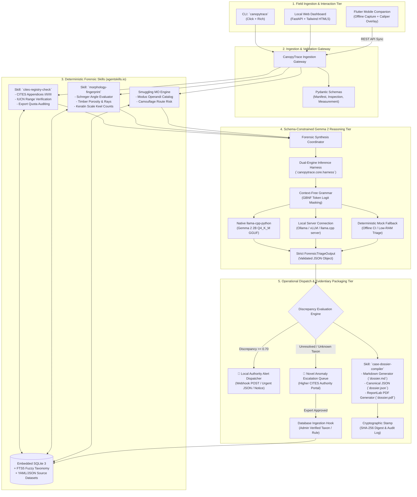
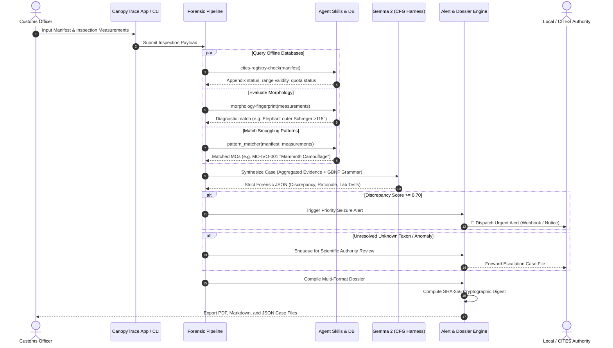

# Architecture Blueprint (ARCHITECTURE.md)

## Project Title: CanopyTrace
**AI Forensic Fingerprinting for Illegal Wildlife & Protected Timber Trade Verification**

---

## 1. High-Level Architecture Overview

CanopyTrace is structured into four primary logical tiers:
1. **Field & Ingestion Tier:** Captures shipping documents, macro-inspection photos, and morphological measurements across CLI, Local Web UI, and a cross-platform Flutter Mobile companion.
2. **Deterministic Forensic Skills Tier:** Implements modular, reproducible, offline forensic capabilities complying with the `agentskills.io` standard (`cites-registry-check`, `morphology-fingerprint`, `case-dossier-compiler`) backed by an embedded SQLite reference database and a smuggling modus-operandi matching engine.
3. **Schema-Constrained Reasoning Tier:** Open-weight Google Gemma 2 2B Instruct driven by Context-Free Grammars (GBNF) for deterministic forensic JSON synthesis, supported by a dual-engine harness (native GGUF, local server, and offline mock fallback).
4. **Evidentiary & Operational Dispatch Tier:** Multi-format tamper-evident dossier generation (PDF, Markdown, JSON + SHA-256), automated local authority alert dispatching, and a novel anomaly escalation feedback loop for scientific authority review and database enrichment.

---

## 2. Complete Architecture Diagram



---

## 3. End-to-End Triage Sequence



---

## 4. Component Deep Dive

### 4.1 Ingestion & Data Validation (`canopytrace.schemas`)
- All incoming payloads pass through Pydantic v2 models.
- Rejects malformed numbers, invalid measurement units, and incomplete chain-of-custody metadata.
- Prepares normalized entity dictionaries for downstream rule engines.

### 4.2 Agent Skills Compliance (`agentskills.io`)
Each skill is completely self-contained in `skills/<skill-name>/`:
- **`SKILL.md`:** Contains standardized YAML frontmatter metadata:
  ```yaml
  name: cites-registry-check
  version: 1.0.0
  description: Checks shipping declarations against offline CITES Appendices and IUCN ranges.
  inputs:
    - manifest: ShippingManifest JSON
  outputs:
    - registry_findings: CITESRegistryResult JSON
  ```
  Followed by clear markdown instructions and progressive disclosure documentation.
- **Standalone Python Entry Point:** Can be executed directly from shell or invoked as a Python module:
  `python skills/cites-registry-check/check_registry.py --input manifest.json`

### 4.3 Offline Reference Database (`canopytrace.db`)
- Zero external runtime server required; uses SQLite 3 with WAL mode enabled.
- Tables:
  - `taxa_cites`: Scientific name, common names, Appendix (I/II/III), commercial annotations, active trade bans.
  - `range_states`: Scientific name, ISO country codes of native geographic distribution.
  - `morphology_rules`: Specimen type, diagnostic feature, operator (`gt`, `lt`, `eq`, `between`), threshold value, target species.
  - `smuggling_mos`: Pattern ID, name, trigger keywords, risk score.
  - `escalation_cases`: Pending and verified anomaly cases.
- Full-text search (FTS5) table for common name and trade slang fuzzy matching.

### 4.4 Gemma 2 Schema-Constrained Decoding Harness (`canopytrace.core.harness`)
- Guarantees zero hallucinations and 100% adherence to the forensic JSON schema.
- Uses `llama-cpp-python` with Context-Free Grammar (GBNF) representation of the Pydantic schema.
- **Fail-safe Fallback:** If GGUF weights are not installed or in automated CI runs, the harness switches to a deterministic heuristic mock engine that computes the exact forensic indicators from rule tables, ensuring test suites and pipelines never crash.

### 4.5 Smuggling Modus Operandi (MO) Engine (`canopytrace.core.pattern_matcher`)
- Applies expert-encoded smuggling pattern rules to spot deceptive declarations (e.g. "antique mammoth" disguise, "agricultural keratin" masking, "plantation teak" cover for rosewood).
- Feeds matched pattern IDs and risk weights into Gemma's synthesis prompt.

### 4.6 Automated Alerting & Anomaly Escalation (`canopytrace.alerts` & `canopytrace.escalation`)
- **Alert Dispatcher:** Formats and broadcasts priority seizure alerts when discrepancy threshold is exceeded.
- **Escalation Queue:** Stores unknown specimens and allows Higher CITES Authorities to verify taxonomy and automatically update the local database using `canopytrace escalate approve`.

### 4.7 Multi-Format Dossier Compiler (`canopytrace.dossier`)
- Generates:
  1. `dossier.pdf`: Publication-quality customs enforcement report with official headers, measurement tables, and legal disclaimers.
  2. `dossier.md`: Auditable GitHub-flavored markdown.
  3. `dossier.json`: Verifiable raw machine-readable data.
  4. `dossier.sha256`: Cryptographic checksum ensuring chain-of-custody evidence has not been altered.

### 4.8 Flutter Mobile Field Companion (`mobile/`)
- Cross-platform Flutter application for customs inspectors working in shipping container berths and inspection docks.
- Includes:
  - Offline inspection form.
  - Interactive Schreger angle caliper tool: inspector aligns on-screen protractor arms with cross-section photos to calculate outer angles automatically.
  - Local SQLite storage with background sync to the local CanopyTrace desktop server.

---

## 5. Security & Legal Considerations

1. **Investigative Support Non-Definitive Disclaimer:** Every dossier, screen, and PDF prominently displays the mandatory legal disclaimer:
   > *"AI findings provide preliminary investigative triage and do not constitute certified legal testimony. Formal seizure and prosecution require confirmatory forensic laboratory analysis."*
2. **Chain-of-Custody Integrity:** Every case output is stamped with an immutable SHA-256 hash calculated over the canonical JSON representation.
3. **Air-Gapped Privacy:** All inference and database queries happen on the local machine; no contraband data, port locations, or manifest details leak to third-party cloud APIs.
